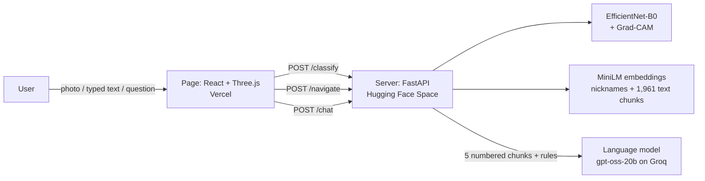

# AstroLens

Upload a photo of a planet, nebula or star cluster. AstroLens recognises it, flies a 3D camera to it, shows a short fact card and a heatmap of what it looked at, and answers your questions from NASA and Wikipedia texts with numbered sources. You can also type where to go ("the red planet", "M42", even "jupitr").

**Live page:** https://astrolens-rho.vercel.app · **Code:** https://github.com/Divyansh-j04/Astro-Lens · Course project for CSE471 (Computer Vision) and CSE472 (Natural Language Processing). Full write-up: [REPORT.md](REPORT.md).

> The live page shows the 3D scene only. The server is not deployed yet, so photo upload, chat and typed commands work only when you run AstroLens locally (see [Run it locally](#run-it-locally)).

## How it works



- **Recognising photos (Computer Vision):** EfficientNet-B0, fine-tuned by transfer learning. Below a confidence threshold it says "not one of my known objects" instead of guessing. Grad-CAM shows which part of the photo decided the answer.
- **Answering questions (NLP, retrieval-augmented generation):** the question is turned into a MiniLM embedding, the 5 closest paragraphs are found, and the language model may answer only from them, citing [1], [2]. If they don't hold the answer, it says "I don't know from my sources."
- **Typed commands (NLP):** text is compared with every object's name and nicknames by meaning (MiniLM) and by spelling, then the page flies there, asks "did you mean", or treats the text as a question.
- **3D scene:** 8,834 real stars, the Solar System, and nebulae and clusters at their real sky positions (not to scale).

## Results

Every number comes from a file in [`ml/results/`](ml/results); see [REPORT.md](REPORT.md) for the tables and how each was measured.

| What | Result | Source |
| --- | --- | --- |
| Photo recognition, test set (189 photos, 14 objects) | 93.1% top-1, 98.4% top-3, macro F1 0.919 | `metrics.json` |
| Out-of-scope photos rejected ("not one of my objects") | 40 of 66 (all 18 everyday photos) | `metrics.json` |
| Chat: answer among the top 5 retrieved paragraphs | 38 of 38 questions | `rag_eval_summary.json` |
| Chat: questions the texts cannot answer, refused | 12 of 12 | `rag_eval_summary.json` |
| Chat: answers containing the expected fact / citing a source | 36 of 38 / 38 of 38 | `rag_eval_summary.json` |
| Typed commands sent to the right object | 41 of 47 | `rag_eval_summary.json` |

Six of the 20 objects (Ring, Horsehead, Pleiades, Beehive, M13, Omega Centauri) had too few free-licence photos to train on; they are in the scene and the chat, but the classifier does not recognise them.

## Run it locally

Requirements: Python 3.12, Node.js 22, and a free [Groq](https://console.groq.com) API key for the chat.

```powershell
# Server
py -3.12 -m venv .venv
.venv\Scripts\Activate.ps1
pip install -r backend\requirements.txt --only-binary=:all:
copy .env.example .env                          # then put your GROQ_API_KEY in .env
cd backend; uvicorn app.main:app --reload       # http://localhost:8000/docs

# Page (second terminal)
cd frontend; npm install; npm run dev           # http://localhost:5173

# Tests
pytest tests
```

The trained weights are not in git. To classify photos locally, rebuild them (below) or copy `efficientnet_b0_noaug.pt` into `backend/weights/`.

## Rebuild everything from scratch

```powershell
pip install -r ml\requirements.txt              # training libraries (see the file for the GPU build)
python ml\scripts\collect.py; python ml\scripts\topup.py   # download candidate images (time-limited runs)
python ml\scripts\review_sheets.py sheets <class>          # review by eye, see the script's help
python ml\scripts\split.py                      # licence filter, duplicates, 70/15/15 split
python ml\scripts\train.py --no-augment         # the app's model (1.4 min on an RTX 4060)
python ml\scripts\train.py                      # comparison run with augmentation
python ml\scripts\evaluate.py                   # test-set results, threshold, unknown test
python ml\scripts\predict.py photo.jpg          # top 3 for any photo

python ml\scripts\collect_texts.py              # chat texts (Wikipedia, NASA)
python ml\scripts\build_index.py                # MiniLM index
python ml\scripts\eval_rag.py                   # chat and command evaluation
```

Browser checks (from `frontend/`, using the installed Microsoft Edge): `node scripts/check-phase1.mjs`, `check-phase3.mjs`, `check-phase4.mjs`.

## Deploy

Not done yet: these steps put the server online so the live page can use it.

```powershell
python deploy\push_space.py --wait              # server -> Hugging Face Space (needs HF_TOKEN in .env)
python deploy\push_vercel.py --api https://<user>-astrolens.hf.space   # page -> Vercel (needs VERCEL_TOKEN)
python deploy\push_space.py --origins https://<the Vercel address>     # allow the page to call the server
```

Add `GROQ_API_KEY` as a secret in the Space's settings.

## Sources and licences

All training images, chat texts and scene pictures are free-licence (public domain, CC0, CC BY or CC BY-SA) and credited in [ml/data/SOURCES.md](ml/data/SOURCES.md). Planet textures: [Solar System Scope](https://www.solarsystemscope.com/textures/) (CC BY 4.0). Stars: HYG Database v4.1 (CC BY-SA 4.0).

## Limitations

- The classifier knows 14 objects. Other galaxies and nebulae often get a confident wrong guess instead of "not one of my objects".
- Most training photos are processed archive images (Hubble, Webb, spacecraft); phone photos through a small telescope may score lower, and sideways photos are harder.
- The chat knows only its 124 documents, and answers depend on Groq's free service.
- The 3D scene compresses sizes and distances, and the planets do not move along their orbits.

More in [REPORT.md, section 11](REPORT.md#11-limitations-and-future-work).
