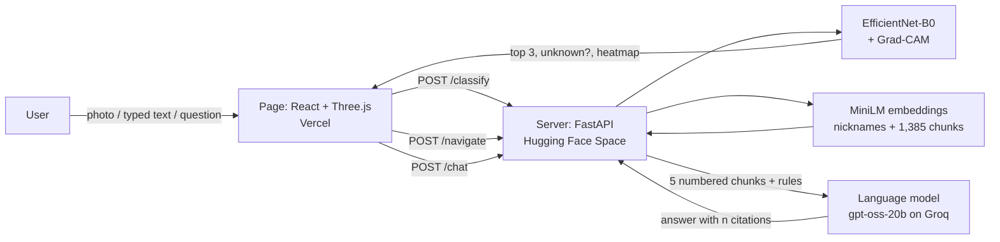
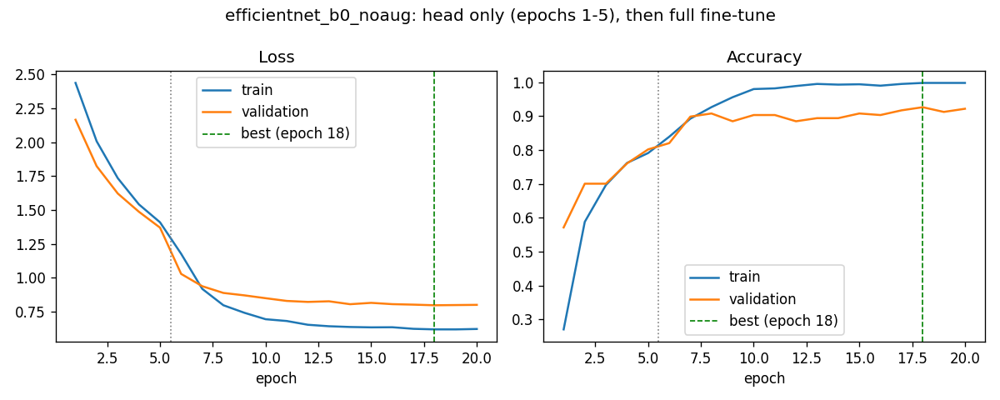
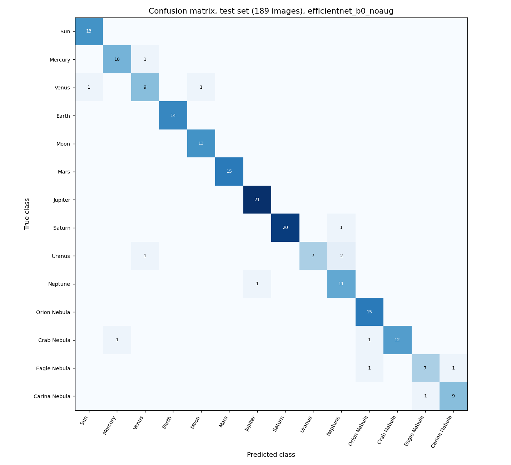
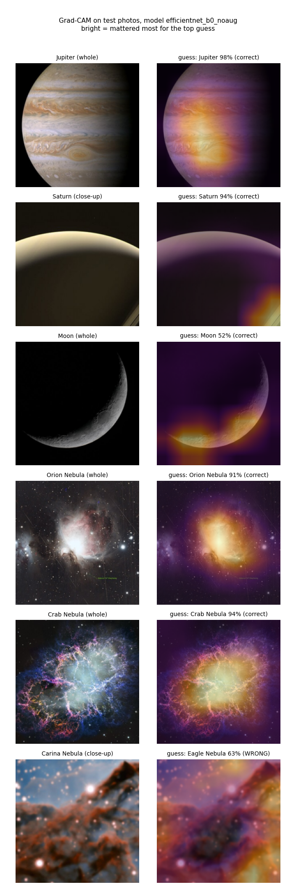

# AstroLens: Project Report

> Filled in phase by phase. Every number comes from a file in `ml/results/` written by a script, and the file is named next to the table. Empty cells mean that phase has not run yet.

## 1. Title

- **Project:** AstroLens: recognising celestial objects from photos, with a 3D explorer and a cited chat assistant
- **Author:** Divyansh (registration number: _to add_)
- **Courses:** CSE471 Computer Vision, CSE472 Natural Language Processing
- **Date:** _to add at submission_
- **Live link:** _Phase 5_
- **Repository:** https://github.com/Divyansh-j04/Astro-Lens

## 2. Abstract

AstroLens is a web page where a user uploads a photo of a planet, nebula or star cluster, and the page recognises it, flies a 3D camera to it, and answers questions about it with cited sources.
- **Recognition:** an EfficientNet-B0 network, fine-tuned by transfer learning on 1,401 free-licence images of 14 objects. On held-out test photos it gets 93.1% top-1 and 98.4% top-3 accuracy (macro F1 0.919).
- **Not one of my objects:** a confidence threshold chosen on validation data rejects 40 of 66 out-of-scope photos, including every everyday photo.
- **Explanation:** a Grad-CAM heatmap shows which part of the photo decided the answer.
- **Questions:** retrieval-augmented generation over 76 Wikipedia and NASA documents (MiniLM embeddings, a language model told to answer only from the retrieved text). The answer was in the top 5 retrieved paragraphs for 30 of 30 test questions, and 10 of 10 unanswerable questions were refused.
- **Typed commands:** names, nicknames and typos reach the right object 36 of 40 times.

## 3. Problem and objectives

**The problem.** People who photograph the sky, or find a space picture online, often cannot tell what they are looking at. A search engine needs a name, and a general chatbot may make up facts with no way to check them.

**Objectives:**
1. Recognise 20 well-known objects (the Sun, Moon, 8 planets, 6 nebulae, 4 star clusters) from a photo, including recognisable close-ups such as Jupiter's Great Red Spot, and say "not one of my known objects" for anything else (Computer Vision).
2. Show why the model decided (Grad-CAM heatmap).
3. Place the result in context: a 3D scene with real sky positions that flies to the object and shows a short fact card.
4. Answer follow-up questions only from trustworthy texts, with numbered sources, and say "I don't know" otherwise (NLP: retrieval and grounded generation).
5. Understand typed commands, including nicknames and typos ("the red planet", "jupitr") (NLP: semantic matching).
6. Measure every part with a script and report every number from its results file.

Objective 1 was met for 14 of the 20 objects: six had too few free-licence photos to train and test fairly (Section 5). They remain in the scene and the chat.

## 4. System overview

1. **Photo.** The page sends it to `/classify`. The server returns the top 3 guesses, whether it is unknown, and the heatmap. The page flies to the top guess and opens its card, or shows the unknown message.
2. **Typed text.** The page sends it to `/navigate`. The server compares it with every name and nickname and says: fly there, ask which of two objects, or treat it as a question.
3. **Question.** The page sends it, with the current object and the last messages, to `/chat`. The server finds the 5 closest paragraphs, and the language model answers from them with [n] citations. The page shows the answer with numbered source links.

The page is static files on Vercel. The server, with the trained model, the texts and the search index, runs in one Docker container on a free Hugging Face Space. The language model is called over the internet (Groq).

### 3D scene (Phase 1)

- **Placing deep-space objects from sky coordinates.** With right ascension α, declination δ (in radians) and distance d: x = d·cos δ·cos α, y = d·cos δ·sin α, z = d·sin δ (x points to α = 0h, z to the north celestial pole). Three.js uses y as "up", so the page uses (x, z, −y). Code: `frontend/src/scene/scale.js` (`skyToScene`).
- **Display distance.** Real distances run from 444 ly (Pleiades) to 24,100 ly (M13), so the page uses d = 4 × √(light-years): Pleiades 84 units, M13 621 units. Directions are exact; only distances are compressed. A **True distances** switch (deep-space view) glides every nebula and cluster to its real, linear distance (1,000 light-years = 100 units: Pleiades 44 units, M13 2,410) in the same direction; the camera travels with the object being viewed, and the overview reframes to fit them all. Pictures keep growing with camera distance, so far objects stay visible.
- **Stars.** The 8,834 HYG stars keep their real direction but are drawn on a far sphere that moves with the camera, so they behave like a sky at infinity. Size comes from magnitude, colour from colour index (blue for hot stars, orange-red for cool ones).
- **Solar System.** Sizes and orbits are compressed with a square root: radius = 0.0075 × √(radius in km), orbit = 6 + 10 × √(AU). The Sun is fixed at radius 3 so it does not swallow Mercury. The page is labelled "not to scale".
- **Two scene modes.** Planets are light-minutes away and nebulae thousands of light-years away, so one camera view cannot show both. A fly-to into the other mode first pulls the camera back to that mode's overview over 2.5 s while the planets and nebula pictures cross-fade, then flies to the object.
- **Fly-to.** GSAP animates the camera position and its look-at point with an ease-in-out curve. A flight takes 1 + distance/400 seconds, clamped to 1.2 to 3 s. Mouse controls are locked during a flight. For a nebula or cluster, the camera stops on the line from Earth to the object, so the stars behind it are its real constellation.

### Upload and classify (Phase 3)

- **Path of a photo.** The page checks the file in the browser (an image, at most 8 MB) and sends it to `POST /classify` as a form upload.
- **Server checks.** The server checks it again:
  - not an image → 415 with a plain message;
  - over 8 MB or over 40 million pixels → 413;
  - damaged or empty → 400.
- **Classifying.** The server turns the photo upright if a phone stored it sideways (EXIF), crops the centre exactly as in training, and runs the model once on the CPU. That one pass gives the top 3 probabilities and the Grad-CAM heatmap.
- **The answer.** The reply has the top 3 (ids and names from `objects.json`), `is_unknown` (top guess below the 0.46 threshold), the threshold, how many objects the classifier knows, the heatmap as a base64 PNG, and the time taken.
- **What the page does next.**
  - Known object: the page flies to the top guess and opens its card with a confidence badge (green above 80%, amber 55-80%, red below 55%). "Top-3 guesses" lists all three with bars, and clicking one flies there instead.
  - Unknown (below the threshold): the camera does not move. The panel says "This doesn't look like one of the 14 objects I can recognise" and lists the closest 3.
  - The heatmap can be faded in over the thumbnail.
- **Loading the model.** It is loaded once when the server starts, and one warm-up image is run so the first upload is not slow.
- **Grad-CAM** (`backend/app/cv/gradcam.py`):
  - It takes the gradient of the top guess's score with respect to the last convolution block's 1,280 feature maps (7 x 7 cells each).
  - It averages each map's gradient into a weight, adds up the maps times their weights, keeps the positive part, and stretches the result to the photo's size.
  - Bright areas are the parts that raised the top guess's score the most.

## 5. Dataset

Source: `ml/results/dataset_counts.json`, written by `ml/scripts/split.py`. Sources and licences: `ml/data/SOURCES.md`.

- **Collection.** Candidate images came from Wikimedia Commons (`ml/scripts/collect.py`) and from six space-agency archives: ESA/Hubble, ESA/Webb, NOIRLab, ESO, NASA/JPL Photojournal and NASA DSCOVR EPIC (`ml/scripts/topup.py`). Deep-sky classes were also searched by catalogue name (M42, NGC 1976, M1, M16, NGC 3372, and so on).
- **Licences.** Only public domain, CC0, CC BY, CC BY-SA and NASA images were used (`ml/scripts/licences.py`); 54 candidates were left out for their licence.
- **Review by eye.** Every candidate was checked on numbered contact sheets (`ml/scripts/review_sheets.py`). Each rejection is logged with its reason in `ml/data/review_excluded.csv`: charts, labelled panels, collages, artwork, the wrong object, near-black frames, and close-ups too zoomed in to recognise. Recognisable close-ups were kept and tagged in `ml/data/review_closeups.csv`: Jupiter's Great Red Spot, Saturn's rings, sunspots, the Pillars of Creation, Carina's Cosmic Cliffs. Close-ups are at most 30% of a class, or 60% for classes under 80 images.
- **Duplicates.** Each image is described by the EfficientNet-B0 ImageNet features and compared with cosine similarity:
  - 0.985 or more: the same picture, so only one copy is kept.
  - 0.95 or more: versions of one picture (other crops or colours). They are kept, but always in the same part of the split, so a picture cannot be in both training and test.
  - In all, 233 images fell into such groups, and 0 groups spanned two classes.
- **Split.** 70 / 15 / 15 by group, with a fixed seed per class, done separately for whole-object and close-up images. The split is one list, `ml/data/split.csv`. At most 150 images per class.
- **Classes left out.** Six objects could not reach 50 usable free-licence images, so they are left out of the classifier: Ring Nebula, Horsehead Nebula, Pleiades, Beehive Cluster, M13 and Omega Centauri. They stay in the 3D scene, the cards and the chat. The classifier has 14 classes.

| Stage | Images |
| --- | --- |
| Candidates downloaded | 4,144 |
| Kept after review | 1,723 |
| Left after removing duplicates | 1,599 |
| Used (after the 150 cap, close-up cap and left-out classes) | 1,401 (1,071 whole, 330 close-up) |
| Train / validation / test | 995 / 217 / 189 |

**Images per class**

| Class | Candidates | After review | After duplicates | Used | Whole | Close-up | Train | Val | Test |
| --- | --- | --- | --- | --- | --- | --- | --- | --- | --- |
| Sun | 245 | 106 | 106 | 106 | 86 | 20 | 75 | 18 | 13 |
| Mercury | 322 | 179 | 176 | 82 | 33 | 49 | 59 | 12 | 11 |
| Venus | 289 | 86 | 84 | 84 | 79 | 5 | 60 | 13 | 11 |
| Earth | 224 | 99 | 99 | 98 | 69 | 29 | 70 | 14 | 14 |
| Moon | 260 | 92 | 92 | 92 | 87 | 5 | 65 | 14 | 13 |
| Mars | 457 | 117 | 111 | 111 | 97 | 14 | 78 | 18 | 15 |
| Jupiter | 449 | 210 | 204 | 150 | 105 | 45 | 106 | 23 | 21 |
| Saturn | 381 | 191 | 182 | 150 | 105 | 45 | 106 | 23 | 21 |
| Uranus | 330 | 108 | 76 | 76 | 76 | 0 | 54 | 12 | 10 |
| Neptune | 274 | 107 | 84 | 84 | 69 | 15 | 61 | 11 | 12 |
| Orion Nebula | 298 | 147 | 135 | 128 | 90 | 38 | 90 | 23 | 15 |
| Crab Nebula | 226 | 120 | 103 | 103 | 95 | 8 | 73 | 16 | 14 |
| Ring Nebula (left out: under 50) | 121 | 60 | 42 | 42 | 42 | 0 | 30 | 6 | 6 |
| Eagle Nebula | 146 | 68 | 62 | 62 | 27 | 35 | 44 | 9 | 9 |
| Carina Nebula | 243 | 93 | 85 | 75 | 53 | 22 | 54 | 11 | 10 |
| Horsehead Nebula (left out: under 50) | 17 | 13 | 13 | 13 | 9 | 4 | 10 | 2 | 1 |
| Pleiades (left out: under 50) | 21 | 8 | 8 | 8 | 6 | 2 | 7 | 1 | 0 |
| Beehive Cluster (left out: under 50) | 3 | 2 | 2 | 2 | 2 | 0 | 2 | 0 | 0 |
| Hercules Cluster (M13) (left out: under 50) | 8 | 6 | 6 | 6 | 4 | 2 | 5 | 1 | 0 |
| Omega Centauri (left out: under 50) | 31 | 14 | 14 | 14 | 8 | 6 | 11 | 2 | 1 |

## 6. Image classifier

Source: `ml/results/train_efficientnet_b0_aug.json` and `ml/results/train_efficientnet_b0_noaug.json`, written by `ml/scripts/train.py`. Model code: `backend/app/cv/classifier.py`.

- **Model.** EfficientNet-B0 with ImageNet weights (torchvision). Its last layer is replaced by a 14-class layer (transfer learning).
- **Stage 1, 5 epochs.** The backbone is frozen and only the new layer learns (AdamW, learning rate 3e-4).
- **Stage 2, up to 15 epochs.** All layers learn (AdamW, learning rate 1e-4 on a cosine decay).
- **Other settings.** Weight decay 1e-4, label smoothing 0.1, batch 32, input 224 x 224. Early stopping keeps the epoch with the lowest validation loss (patience 4).
- **Augmentation** (comparison run only). Random crops keeping 25-100% of the image (this also makes close-up-like views), horizontal and vertical flips, any rotation, colour jitter, and grey 10% of the time.
- **Runs.** Both on an NVIDIA RTX 4060 Laptop GPU with PyTorch 2.8.0: 20 epochs each, best epoch 18 in both, no early stop.
  - Without augmentation: 1.4 min, validation accuracy 92.6%.
  - With augmentation: 3.08 min, validation accuracy 88.0%.
  - Training curves: `ml/results/training_curve_efficientnet_b0_aug.png` and `..._noaug.png`.

- **Which model the app uses.** The model **without augmentation**, chosen on the validation set (see section 7). Its weights are `backend/weights/efficientnet_b0_noaug.pt`.
- **Confidence threshold.** Chosen on the validation set only: the 5th percentile of the top-1 confidence on correctly classified validation images, which is **0.46**. Below it, the answer is "not one of my known objects". The threshold is stored in `backend/app/data/classifier.json`.
- **Command-line check.** `python ml/scripts/predict.py photo.jpg` prints the top 3 guesses and the unknown message.

## 7. Classifier results

Source: `ml/results/metrics.json`, written once by `ml/scripts/evaluate.py` on the 189 test images, which were not used before this point.

**Table A: classifier results (test set)**

| Model | Top-1 accuracy % | Top-3 accuracy % | Macro F1 | Training time (min) |
| --- | --- | --- | --- | --- |
| EfficientNet-B0 without augmentation | 93.1 | 98.4 | 0.919 | 1.4 |
| EfficientNet-B0 with augmentation | 88.9 | 97.4 | 0.861 | 3.08 |

**Accuracy by view type (test set, top-1 / top-3 %)**

| Model | Whole objects (147) | Close-ups (42) | All (189) |
| --- | --- | --- | --- |
| Without augmentation | 92.5 / 98.0 | 95.2 / 100.0 | 93.1 / 98.4 |
| With augmentation | 88.4 / 96.6 | 90.5 / 100.0 | 88.9 / 97.4 |

**Choosing the app's model (validation set only).** The augmented model was first planned as the app's model. It scored lower on clean validation photos (88.0% against 92.6%), but augmentation is meant to help with messy real uploads. So both models were also scored on altered copies of the 217 validation photos, one change at a time. Source: `ml/results/robustness_val.json`, written by `ml/scripts/robustness.py`.

| Validation photos changed to | Imitates | Without augmentation | With augmentation |
| --- | --- | --- | --- |
| clean | the photo as it is | 92.6 | 88.0 |
| rotated 45 deg | a tilted phone or telescope shot | 86.2 | 87.6 |
| rotated 90 deg | a sideways photo | 83.4 | 88.0 |
| blurred | out of focus or atmospheric shake | 84.3 | 80.2 |
| darker (50%) | under-exposed | 91.2 | 88.0 |
| brighter (160%) | over-exposed | 86.2 | 84.3 |
| JPEG quality 10 | a heavily compressed chat-app image | 77.9 | 71.9 |
| low resolution (64 px) | a small or distant object, digitally zoomed | 74.7 | 75.1 |
| sensor noise | a grainy night-time phone photo | 60.4 | 54.4 |
| grey | a black-and-white photo | 83.4 | 80.6 |
| centre crop 50% | a zoomed-in close-up | 78.3 | 81.1 |
| **Average over the 10 altered versions** | | **80.6** | **79.1** |

- The model without augmentation won on clean photos and on 6 of the 10 altered versions: blur, darker, brighter, JPEG, noise and grey.
- The augmented model won on the changes it was trained with: rotation (it scores the same sideways as upright), tight crops and low resolution.
- One validation photo is about 0.5 points, so most gaps are a handful of photos.

The model without augmentation was chosen because it is better on clean photos and slightly better on average over the altered ones. The choice was made on validation photos only; the test set was not used to choose.

A likely reason augmentation did not pay off here: the validation and test images are clean archive photos, much like the training images. Its rotation and crop changes also did nothing for blur, noise or compression, which it never saw. 189 test images is also a small sample, where one image is about 0.5 points.

**Table B: per-class results (model without augmentation, the app's model, test set)**

| Class | Train images | Test images | Precision | Recall | F1 |
| --- | --- | --- | --- | --- | --- |
| Sun | 75 | 13 | 0.929 | 1.0 | 0.963 |
| Mercury | 59 | 11 | 0.909 | 0.909 | 0.909 |
| Venus | 60 | 11 | 0.818 | 0.818 | 0.818 |
| Earth | 70 | 14 | 1.0 | 1.0 | 1.0 |
| Moon | 65 | 13 | 0.929 | 1.0 | 0.963 |
| Mars | 78 | 15 | 1.0 | 1.0 | 1.0 |
| Jupiter | 106 | 21 | 0.955 | 1.0 | 0.977 |
| Saturn | 106 | 21 | 1.0 | 0.952 | 0.976 |
| Uranus | 54 | 10 | 1.0 | 0.7 | 0.824 |
| Neptune | 61 | 12 | 0.786 | 0.917 | 0.846 |
| Orion Nebula | 90 | 15 | 0.882 | 1.0 | 0.938 |
| Crab Nebula | 73 | 14 | 1.0 | 0.857 | 0.923 |
| Ring Nebula | left out (42 usable images, under 50) | | | | |
| Eagle Nebula | 44 | 9 | 0.875 | 0.778 | 0.824 |
| Carina Nebula | 54 | 10 | 0.9 | 0.9 | 0.9 |
| Horsehead Nebula | left out (13 usable images, under 50) | | | | |
| Pleiades | left out (8 usable images, under 50) | | | | |
| Beehive Cluster | left out (2 usable images, under 50) | | | | |
| Hercules Cluster (M13) | left out (6 usable images, under 50) | | | | |
| Omega Centauri | left out (14 usable images, under 50) | | | | |

Average over the 14 classes: precision 0.927, recall 0.916, F1 0.919 (macro F1 from Table A).

**Confusion matrix** (app's model): `ml/results/confusion_matrix.png`. Only 13 of 189 test images are wrong, and no pair is confused more than twice:
- **Uranus taken for Neptune** (2). Both are small, nearly featureless blue-green discs, and processed images can make one look like the other.
- **Venus** (1 each taken for the Sun and the Moon, and 1 Mercury taken for Venus). Venus is a bright, featureless disc like the Sun in amateur photos, and its ultraviolet and radar images are grey and mottled like Mercury's or the Moon's surface.
- Every other mistake is a single image, for example Saturn taken for Neptune, Neptune for Jupiter, Eagle for Orion, and Uranus for Venus.

**Threshold on the test set:**
- 95.2% of test images are above the threshold, and 94.4% of those are right.
- 6 correct answers fall below the threshold, and 10 wrong answers are above it.

**Unknown-object test:** 66 photos of things outside the 14 classes (`ml/data/manifest_unknown.csv` and the "unknown" rows of `ml/data/manifest.csv`, reviewed by eye). The threshold rejected **40 of 66 (60.6%)**:

| Unknown type | Photos | Rejected |
| --- | --- | --- |
| Cats | 6 | 6 |
| Dogs | 6 | 6 |
| Mountains | 6 | 6 |
| Galaxies (Andromeda, Whirlpool, Sombrero) | 16 | 12 |
| Other nebulae (Lagoon, Helix, Tarantula) | 20 | 6 |
| Comets (NEOWISE and others) | 11 | 3 |
| Pluto | 1 | 1 |

All 18 everyday photos are rejected. Most galaxies are too, but most other nebulae and comets are not: the model gives them a confident guess among the nebulae it knows. One confidence threshold cannot separate "a nebula I know" from "a nebula I don't" well. (With the augmented model the same test rejected only 26 of 66, because its threshold, 0.36, was lower. Source: `ml/results/metrics.json` as committed in 9280eb1, before the switch.)

**Grad-CAM examples (6):** `ml/results/gradcam/gradcam_examples.png`, written by `ml/scripts/gradcam_examples.py`. These are test photos and the app's model, picked by a fixed rule: the first correct test photo of five classes, plus the first wrong test answer. Details are in `ml/results/gradcam/examples.json`.

| Photo | Top guess | Right? |
| --- | --- | --- |
| Jupiter (whole) | Jupiter 98% | yes |
| Saturn (close-up) | Saturn 94% | yes |
| Moon (whole) | Moon 52% | yes |
| Orion Nebula (whole) | Orion Nebula 91% | yes |
| Crab Nebula (whole) | Crab Nebula 94% | yes |
| Carina Nebula (close-up) | Eagle Nebula 63% | no |

What the heatmaps show:
- **Jupiter:** the cloud bands.
- **Orion Nebula:** its bright core.
- **Crab Nebula:** the filament cloud.
- **Saturn close-up:** the ring edge in the corner, not the plain disc.
- **Moon:** the lit edge of the crescent.
- **The mistake:** a Carina close-up full of dark dusty pillars was read as Eagle, whose best-known photos (the Pillars of Creation) are exactly that.

## 8. Chat and command matching

The chat uses retrieval-augmented generation (RAG). It looks up the paragraphs most related to the question, and the language model may only answer from those. Nothing is trained in this phase: both models are used as they are, and this phase's work is the texts, the search, the prompt rules and the evaluation.

- **Texts** (`ml/scripts/collect_texts.py`, `ml/data/SOURCES.md`):
  - 76 documents, 195,241 words, 3 to 5 per object.
  - Sources: the English Wikipedia article, the Simple English Wikipedia article (a plain-language explainer), the NASA Science page and, for planets, its "facts" page. Deep-sky objects also get related Wikipedia articles, such as "Pillars of Creation" for the Eagle Nebula and "Arecibo message" for M13.
  - Saved as text files with the title, link, licence and date at the top (`backend/app/data/corpus/`).
- **Chunks:**
  - 180 words each, overlapping by 40 words, so a fact on a boundary is whole in one chunk. That gives 1,385 chunks (`ml/results/index_summary.json`).
  - The plan said about 300 words, but MiniLM reads only the first 256 word pieces (about 190 words) and ignores the rest. 300-word chunks would be only partly searchable.
  - Each chunk keeps its object, title, link and section heading.
- **Embeddings:**
  - `all-MiniLM-L6-v2` (sentence-transformers, 384 numbers per text), pinned to one exact model version.
  - The text embedded is "object name - section: chunk", so a chunk about "its rings" still says which object it is about.
  - Building the index took 1.23 min on the CPU (`ml/scripts/build_index.py`).
- **Search** (`backend/app/nlp/retriever.py`):
  - The question becomes a vector, and its cosine similarity with all 1,385 chunk vectors is one NumPy matrix product. This is the same computation as FAISS's basic "flat" index.
  - The top 5 chunks are kept. Chunks about the object on screen get +0.10, and the object's name is put in front of the question, so "how far is it?" on the Venus card searches as "Venus: how far is it?".
- **Language model:**
  - `openai/gpt-oss-20b` on Groq, temperature 0.2, reasoning effort "low" (`backend/app/nlp/chat.py`).
  - The prompt holds rules, the 5 numbered chunks, the last 4 messages of the conversation and the question.
  - The rules: answer only from the numbered sources; put [n] after every fact; if the sources do not contain the answer, reply exactly "I don't know from my sources."; 2 to 4 plain sentences; "it" means the object on screen.
  - The server marks which sources the answer actually cites, and the page lists those under the answer as links.
- **Commands** (`backend/app/nlp/navigator.py`, `POST /navigate`):
  1. Command words such as "take me to" or "show me" are removed.
  2. The rest is compared with every object's name and nicknames from `objects.json`. The score is the higher of the MiniLM similarity (meaning) and a letter-by-letter spelling similarity (Python's difflib, for typos MiniLM cannot read, such as "jupitr").
  3. The decision:
     - a question ("how hot is Venus?") goes to the chat, and the page flies to the object it names;
     - a score of at least 0.60 and at least 0.05 ahead of the next object flies there;
     - a score from 0.45 to 0.60, or two objects within 0.05 of each other (such as just "nebula"), shows "Did you mean" with two buttons;
     - anything lower is passed to the chat as a question.

## 9. Chat results

Source: `ml/results/rag_eval_summary.json`, `ml/results/rag_eval.csv` and `ml/results/navigate_eval.csv`, written by `ml/scripts/eval_rag.py`. The test sets are `ml/data/eval/rag_questions.json` and `ml/data/eval/commands.json`.
- **Chat test set:** 30 questions, each tagged with the document that holds its answer and a short phrase the answer must contain, plus 10 questions the texts cannot answer.
- **Command test set:** 40 phrases. 10 of the 15 nicknames are listed in `objects.json`; the other 5 ("the hottest planet", "our nearest star", ...) are paraphrases the matcher has never seen.

**Table C: chat retrieval and answers**

| Measure | Result |
| --- | --- |
| Questions where the right source was in the top 5 (of 30): the tagged document / any chunk containing the answer | 22 / 30 |
| Answers fully supported by the sources, manual check (of 10) | _author to check: `ml/results/rag_manual_check.csv`_ |
| Answers containing the expected fact, automatic check (of 30) | 29 |
| Answers citing at least one source (of 30) | 29 |
| Answers citing the tagged document (of 30) | 17 |
| Answerable questions wrongly refused (of 30) | 0 |
| Unanswerable questions correctly refused (of 10) | 10 |
| Median answer time (seconds; search 46.8 ms + language model 812.2 ms) | 0.91 |

**Search detail (of 30 questions).**
- "Tagged document" means a chunk from the document tagged as holding the answer.
- "Answer found" means any chunk that contains the expected answer. The same fact is often in Wikipedia and in NASA, so this is the fairer test.

| Setting | Tagged doc @1 / @3 / @5 | Answer found @1 / @3 / @5 |
| --- | --- | --- |
| Question only (no object context) | 14 / 22 / 22 | 19 / 26 / 30 |
| App: object name in front + current-object bonus | 14 / 21 / 22 | 18 / 27 / 30 |

**Reading the results:**
- **Object context:** it makes no difference on these 30 questions, because each one already names its object or a distinctive topic. It is there for follow-ups that do not name the object. The browser check's follow-up "How long is a day there?" was answered about Mars, and the tests check that the current object's texts come first.
- **The automatic fact check:** it is strict. After the first run, three equivalent values that are in the sources were added to the answer key (4.5 billion years for the Sun, 70.8% for Earth's water, 9.9 hours for Jupiter's day). No-break spaces the model writes inside numbers ("15 million") are now treated as normal spaces. The saved answers, and the search results, were then re-checked against the updated key without asking the model again (`eval_rag.py --rescore`). The one remaining miss quotes Wikipedia's 2,200 km/h for Neptune's winds rather than NASA's 1,200 mph in the key, so the key is stricter than the answer. One correct answer (how Neptune was discovered) has no [n] markers and so counts as uncited.
- **Timing:** the evaluation waits 15 s between questions. In a first run with only 2 s between them, the free Groq tier slowed back-to-back calls to a median of 9533.6 ms (`ml/results/rag_eval_summary_2s_spacing.json`), which measures the free tier's limit, not one user's wait.
- **Repeat runs:** the language model runs at temperature 0.2, so a repeat run can word answers differently.

**Three example conversations** (from the browser check, `ml/results/phase4_chat_check.json`; it saves the page's text, so the citation links are written back here as [n]):

1. **On the Mars card, a suggested question.**
   > **Q:** Why is Mars red?
   > **A:** Mars looks red because iron in its rocks, dust, and regolith oxidizes, or rusts, giving the surface a reddish hue. The iron minerals in the Martian dirt react with the thin atmosphere, creating iron oxide that spreads across the planet’s surface and dust storm…
   > **Sources:** [1]Mars · Overview (simple.wikipedia.org); [2]Mars: Facts · Overview (science.nasa.gov); [5]Mars · Overview (en.wikipedia.org)

   Then a follow-up that does not name the planet:
   > **Q:** How long is a day there?
   > **A:** A day on Mars, called a sol, lasts about 24.6 hours [1][2]. This is only slightly longer than an Earth day, which is 24 hours. The extra 39 minutes come from Mars’s slower rotation relative to its orbit around the Sun.

2. **Typed in the command bar from anywhere:** "how hot is Venus?". The page flew to Venus and answered:
   > Venus’ surface temperature averages about 735 K (462 °C; 864 °F) [2]. That makes it hotter than Mercury, even though Venus receives only about a quarter of Mercury’s solar energy [2]. The extreme heat is caused by a runaway greenhouse effect from its thick CO₂ atm…
   > **Sources:** [1]Venus · Overview (en.wikipedia.org); [2]Venus · Atmosphere and climate (en.wikipedia.org); [3]Venus: Facts · Our Solar System (science.nasa.gov)

3. **A question the texts cannot answer:**
   > **Q:** Who won the 2022 football World Cup?
   > **A:** I don't know from my sources.

**Two failures:**
1. **An answer without citations.**
   - Asked "How was Neptune discovered?", the model gave a correct answer but left out the [n] markers:
     > Neptune was first predicted by mathematicians Urbain Le Verrier and John Couch Adams, who calculated that an unseen planet was tugging on Uranus’s orbit. Their calculations led astronomer Johann Galle…
   - The page then lists no sources under that answer, even though the paragraphs were retrieved. The rule "cite every fact" is followed in 29 of 30 answers, not all of them.
2. **A nickname the matcher was not given.**
   - "the planet with the giant storm" went to Neptune instead of Jupiter (`ml/results/navigate_eval.csv`).
   - MiniLM found Neptune's nickname "the windy planet" closer in meaning than any of Jupiter's nicknames ("the gas giant", "Great Red Spot planet"). The only fix is more nicknames in `objects.json`.

**Table D: command matching**

| Phrase type | Phrases | Accuracy % |
| --- | --- | --- |
| Exact names | 15 | 100 (15 of 15) |
| Nicknames | 15 | 80 (12 of 15) |
| Typos or extra words | 10 | 90 (9 of 10) |
| **All** | 40 | **90** (36 of 40) |

**What each part adds (same 40 phrases):**

| Setting | Exact | Nicknames | Typos | All | Asked "did you mean" | Median time (ms) |
| --- | --- | --- | --- | --- | --- | --- |
| MiniLM only | 15/15 | 12/15 | 3/10 | 30/40 | 4 | 11.9 |
| MiniLM + spelling | 15/15 | 12/15 | 9/10 | 36/40 | 1 | 13.8 |
| MiniLM + spelling + margin (app) | 15/15 | 12/15 | 9/10 | 36/40 | 2 | 14.1 |

The spelling similarity fixes most typos (MiniLM reads "jupitr" as unrelated word pieces). The margin makes a bare "nebula" ask instead of guessing; it changes no answer in this set. The phrases the app still gets wrong: "the hottest planet" (clarify, expected venus); "Earth's natural satellite" (clarify, expected moon); "the planet with the giant storm" (fly_to neptune, expected jupiter); "can you show me the ring nebula please" (chat ring_nebula, expected ring_nebula).

**Phase 4 browser check.** Source: `ml/results/phase4_chat_check.json`, written by `node scripts/check-phase4.mjs` (run from `frontend/`), with the real server and language model in Microsoft Edge. Screenshots are in `ml/results/phase4_screens/`.

| Check | Result |
| --- | --- |
| Command "take me to the red planet" | flew to mars, card "Mars" |
| "Chat more": suggested questions shown | 3 |
| First suggested question: "Why is Mars red?" | answered with 3 cited sources, all links https |
| Follow-up "How long is a day there?" (no object named) | answered about Mars: "A day on Mars, called a sol, lasts about 24.6 hours [1][2]. This is only slightly longer than …" |
| "Who won the 2022 football World Cup?" | "I don't know from my sources.", no sources listed |
| Command "nebula" | asked "Did you mean": Eagle Nebula / Ring Nebula; clicking the first flew to eagle_nebula |
| Command "jupitr" | flew to jupiter |
| Command "how hot is Venus?" | flew to venus and answered in the chat with 3 cited sources |
| Browser console errors | 0 |

## 10. Features delivered

| Phase | Feature | Status |
| --- | --- | --- |
| 0 | Project folders, CLAUDE.md, PLAN.md, REPORT.md, git repository | Done |
| 0 | `objects.json` with 20 objects, validated by a Pydantic schema and tests | Done |
| 0 | `hyg_stars.json`: 8,834 naked-eye stars from the HYG catalogue | Done |
| 0 | Server with `/health` and `/objects`, CORS, request timing log | Done |
| 0 | React + Vite page with Tailwind, React Three Fiber, drei, GSAP, Zustand installed | Done |
| 0 | Groq language model test call (`ml/scripts/check_llm.py`, model `openai/gpt-oss-20b`) | Done |
| 1 | Star field: 8,834 HYG stars, size by magnitude, colour by colour index | Done |
| 1 | Sun, 8 planets and Moon with textures, slow spin, thin orbit rings, Saturn's ring, "not to scale" note | Done |
| 1 | 6 nebulae and 4 clusters as glowing pictures (sprites) at their real RA/Dec, √distance scale | Done |
| 1 | Camera fly-to for all 20 objects; pull-back and cross-fade when the scene mode changes | Done |
| 1 | Glass side panel (26% wide, 14 px blur, collapsible) with the brief card from `objects.json` | Done |
| 1 | Card buttons: "Chat more" opens a placeholder chat view; "Top-3 guesses" is disabled until Phase 3; confidence badge slot is ready | Done (placeholders) |
| 1 | Mouse orbit when idle, locked during a flight; Home button; clickable planets and name labels; loading screen with a progress bar | Done |
| 1 | Temporary "Go to" dropdown of the 20 objects (to be replaced by upload and typed commands) | Done |
| 1 | Browser check script `frontend/scripts/check-phase1.mjs` and 20 screenshots in `ml/results/phase1_screens/` | Done |
| 2 | Image collection from Wikimedia Commons and six space-agency archives, with a licence record for every image (`collect.py`, `topup.py`, manifests) | Done |
| 2 | Licence rule with tests (`ml/scripts/licences.py`, `tests/test_licences.py`) | Done |
| 2 | Review by eye with numbered contact sheets; every rejection logged with a reason (`review_sheets.py`) | Done |
| 2 | Deep-feature duplicate removal and a leak-free 70/15/15 split (`split.py`, `ml/data/split.csv`) | Done |
| 2 | EfficientNet-B0 trained with and without augmentation (`train.py`) | Done |
| 2 | Test-set evaluation: Table A, Table B, accuracy by view, confusion matrix, threshold, unknown test (`evaluate.py`, `ml/results/metrics.json`) | Done |
| 2 | `predict.py photo.jpg` prints the top 3 and the unknown message | Done |
| 2 | Classifier config for the server (`backend/app/data/classifier.json`); weights in `backend/weights/` (not committed) | Done |
| 3 | `POST /classify`: top 3 with probabilities, `is_unknown`, threshold, Grad-CAM heatmap, time taken; model loaded once at startup on the CPU | Done |
| 3 | Upload checks with clear errors: not an image (415), over 8 MB or too many pixels (413), damaged or empty (400) | Done |
| 3 | Grad-CAM written with a PyTorch hook (`backend/app/cv/gradcam.py`); 6 examples saved for the report | Done |
| 3 | Upload box: drag and drop or click, thumbnail, spinner, "waking up" message after 5 s, photo/heatmap toggle | Done |
| 3 | On a result: fly to the top guess and open the card with a coloured confidence badge; "Top-3 guesses" view where clicking a guess flies there | Done |
| 3 | Unknown message with the closest 3 guesses; the camera stays put | Done |
| 3 | Error messages on the page: server unreachable, too large, not an image, server error | Done |
| 3 | API tests (`tests/test_api.py`) and browser check (`frontend/scripts/check-phase3.mjs`) | Done |
| 4 | Chat texts: 76 documents from Wikipedia, Simple English Wikipedia and NASA, with titles, links and licences (`collect_texts.py`) | Done |
| 4 | Search index: 1,385 chunks embedded with MiniLM (`build_index.py`) | Done |
| 4 | `POST /chat`: top-5 search preferring the current object, answers only from the sources with [n] citations, "I don't know from my sources." otherwise | Done |
| 4 | `POST /navigate`: names, nicknames and typos; fly, "did you mean" with two buttons, or hand over to the chat | Done |
| 4 | Chat panel: 3 suggested questions, numbered source links, typing indicator, one conversation per object, follow-ups keep the object | Done |
| 4 | Command bar replaces the temporary dropdown (object names offered while typing); a typed question flies to its object and answers there | Done |
| 4 | Evaluation: 30 questions + 10 unanswerable, 40 command phrases (`eval_rag.py`); manual-check sheet for 10 answers | Done (manual check: author) |
| 4 | Tests (`tests/test_chat_navigate.py`, language model faked) and browser check (`frontend/scripts/check-phase4.mjs`) | Done |

**Phase 1 scene check.** Source: `ml/results/phase1_scene_check.json`, written by `node scripts/check-phase1.mjs` (run from `frontend/`). The script opened the page in Microsoft Edge 157 (headless) on the author's laptop, which used the real GPU (NVIDIA GeForce RTX 4060 Laptop GPU, through Direct3D 11). The viewport was 1440 × 900. The script picked each object in the dropdown, alternating Solar System and deep space, so 19 of the 20 flights were mode switches.

| Check | Result |
| --- | --- |
| Objects that flew to the planned viewpoint and showed the right card (name and summary), mode, cross-fade, object on screen, controls unlocked after | 20 of 20 |
| Largest camera position error after a flight (scene units) | 0 |
| Stars drawn | 8,834 |
| Frames per second, idle at the overview | 144 (the display's refresh rate) |
| Frames per second during flights, lowest of 20 | 135.5 |
| Mode-switch cross-fade duration | 2.51 to 2.52 s |
| Planet visibility during the first switch, sampled every 100 ms | falls smoothly 1 → 0.99 → 0.97 → … → 0.03 → 0.01 → 0 (no jump) |
| Whole flight into deep space, including the pull-back | 5.51 to 5.52 s |
| Whole flight back into the Solar System, including the pull-back | 3.73 to 3.87 s |
| Page load until the loading screen cleared | 2,226 ms (local development server) |
| Panel width as a share of the window | 0.26 |
| Panel collapse and reopen; "Chat more" view and back to the card | all pass |
| Home button (from deep space): Solar-System mode, camera at the overview, panel hidden | pass |
| Clicking each of the 10 Solar-System name labels, and the Sun's sphere itself | 11 of 11 |
| Angle between the Pleiades and the Crab Nebula as seen from the Sun (both in Taurus) | 24.9° |
| Pleiades to its nearest bright star (brighter than magnitude 4; Alcyone, mag 2.85) | 0.21° |
| Browser console errors | 0 |

The last two sky rows show that the nebula pictures and the HYG stars share one coordinate frame. The Pleiades picture sits 0.21° from a magnitude 2.85 star, which is Alcyone, the cluster's brightest star.

**Phase 3 upload check.** Source: `ml/results/phase3_upload_check.json`, written by `node scripts/check-phase3.mjs` (run from `frontend/`). The script started the real server (model `efficientnet_b0_noaug` on the CPU) and the page, and drove Microsoft Edge on the author's laptop. Its two photos were a Saturn photo from the test set and a cat photo from the unknown-object set. Screenshots are in `ml/results/phase3_screens/`.

| Check | Result |
| --- | --- |
| Saturn photo: top guess | Saturn 78%, not unknown |
| Saturn photo: camera flew to Saturn's viewpoint, card and badge shown | saturn, camera error 0, card "Saturn", badge "78% match" |
| Heatmap toggle (heatmap opacity shown / hidden) | 1 / 0 |
| "Top-3 guesses" view: rows; clicking the 2nd guess flew there | 3; flew to sun, card "Sun" |
| Cat photo: best guess and threshold | Carina Nebula 20%, below 0.46, so unknown |
| Cat photo: message shown; camera moved; object before / after | "This doesn't look like one of the 14 objects I can recognise."; 0; sun / sun |
| Text file | "That file is not an image. Please choose a JPEG, PNG or WebP photo." (checked in the browser) |
| Text file named .jpg | "That file is not an image. Please upload a JPEG, PNG or WebP photo." (checked by the server) |
| File over 8 MB | "That image is larger than 8 MB. Please choose a smaller photo." |
| Server held back for 6.5 s (imitates a sleeping free server) | "Waking up the server… this can take up to a minute" shown after 5 s |
| Server switched off | "Can't reach the AstroLens server. Check your connection, or try again in a minute." |
| Time to classify on the server, median of 10 uploads (CPU, includes Grad-CAM) | 362.7 ms |
| Photo chosen until the answer shows on the page, median of 10 (local server) | 902 ms |
| Unexpected browser console errors | 0 |

The times are on the author's laptop, with the server on the same machine; the deployed times go in Table E (Phase 5).

**Table E: time taken per step (deployed, median of 10 runs)**

| Step | ms |
| --- | --- |
| Upload and classify |  |
| Grad-CAM |  |
| Find paragraphs (search) |  |
| Language model answer |  |

## 11. Limitations and future work

- 36 objects: the 20 from the plan plus 16 significant moons added after Phase 5 (Phobos, Deimos; Io, Europa, Ganymede, Callisto; Titan, Enceladus, Mimas, Rhea, Iapetus; Miranda, Ariel, Titania, Oberon; Triton). The moons are in the 3D scene, the cards and the command matcher, but not in the photo classifier (no training photos were collected for them). Phobos and Deimos are drawn larger than the square-root rule gives (minimum radius 0.06 units), and 15 moons still show plain-colour placeholder surfaces until their maps download.
- The classifier knows 14 of the original 20 objects. Ring Nebula, Horsehead Nebula, Pleiades, Beehive Cluster, M13 and Omega Centauri had too few free-licence photos (under 50 after review) and are left out of the classifier; they are still in the scene and the chat.
- Several classes are below the planned 80 images (Uranus 76, Carina 75, Eagle 62), and the test set has only 9 to 21 images per class, so per-class scores move a lot with one image.
- Eagle Nebula leans on Pillars of Creation close-ups (35 of 62 images).
- Most images are processed archive pictures (Hubble, Webb, spacecraft). Phone or small-telescope photos look different and are likely to score lower.
- The unknown-object test rejects 60.6% of out-of-scope photos (`ml/results/metrics.json`). It rejects all 18 everyday photos, but other nebulae and comets mostly get a confident wrong guess (rejected 6 of 20 and 3 of 11).
- The app's model (without augmentation) is weaker on sideways photos: 83.4% on validation photos rotated 90 degrees, against 92.6% upright (`ml/results/robustness_val.json`). It is also weak on very grainy photos (60.4% with added sensor noise).
- The threshold also rejects 6 of the 189 correct test answers (they fall below 0.46).
- Holdout split only (no k-fold), so there are no confidence intervals on the scores.
- Nebulae are shown as flat images at their real sky position, not true 3D shapes.
- Planet sizes and distances are compressed and labelled "not to scale".
- Object distances are rounded central values; published uncertainties are large for some (Crab Nebula ± 1,600 ly).
- Planets do not move along their orbits; each sits at a fixed spot, and only spins slowly. Their positions round the Sun are spread out for display, not taken from a real date.
- The planets' orbit plane is drawn level with the celestial equator. The real ecliptic is tilted 23.4° from it.
- Stars are drawn at their real direction, but not at their real distance (they sit on a far sphere). The 3D view therefore does not show stars at different depths.
- Orion Nebula and Horsehead Nebula are only 3° apart on the sky, so their pictures overlap. That is true to the sky, but it can make one hard to click.
- The frame rates were measured on one laptop with a fast GPU (RTX 4060). Slower machines, and phones in particular, have not been measured yet (Phase 5).
- Grad-CAM is coarse: the network's last feature maps are 7 x 7 cells, so the heatmap shows roughly where the model looked, not exact outlines. It covers the centre crop the model saw, so the edges of a wide photo are not part of it.
- The 'server waking up' message was tested by holding a request back for 6.5 s, not with a real sleeping server (that comes with deployment in Phase 5).
- The chat knows only its 76 documents. Questions about anything else get "I don't know from my sources.", even when the language model itself would know the answer. That is intended.
- The answers depend on an outside service (Groq's free tier). If it is slow or down, the chat shows an error, and many fast questions in a row are slowed down by its limits.
- The automatic fact check in Table C only looks for a key phrase. Whether each sentence is supported by its cited source needs the manual check (`ml/results/rag_manual_check.csv`).
- The command matcher does not understand descriptions it was not given, such as "the hottest planet" (clarify, expected venus); "Earth's natural satellite" (clarify, expected moon); "the planet with the giant storm" (fly_to neptune, expected jupiter); "can you show me the ring nebula please" (chat ring_nebula, expected ring_nebula). More nicknames in `objects.json` would fix these one by one.
- Search uses one embedding model and no re-ranking step (the full plan's BM25 and cross-encoder were left out to keep it simple). Wikipedia articles are long, so they supply most chunks.
- Star clusters are now 3D balls of stars up close (added after Phase 5 at the author's request), but most of their stars are generated, not catalogued: open clusters as a loose Gaussian swarm, globular clusters with a Plummer profile, with illustrative counts and colours. Only the bright members in the HYG catalogue are real (13 for the Pleiades, 2 for the Beehive, none for the distant globulars), placed in their true sky pattern; their depth is illustrative because catalogue distances are too uncertain. From far away the cluster's photo is shown instead.
- Nebulae are now 3D particle clouds up close, built from the pixels of their own photo (added after Phase 5 at the author's request). The depth is illustrative: the real 3D shape of most nebulae is not known, so each cloud is simply thicker in the middle, with brighter gas a little closer. Only the selected nebula or cluster turns 3D; the others stay photos.
- Future work (beyond this project): planets move along their orbits from the moment the page loads. Speeds come from each planet's period, run on a sped-up clock, because real speed is too slow to see (Earth moves about 1° a day). The motion pauses in deep-space mode, so the page does no orbit work while the planets are hidden, and resumes on return. The fly-to must then follow a moving planet: the camera keeps tracking it after landing.
- Future work (beyond this project): an OpenCV auto-crop before classification. It would find the bright disc in photos where the Moon or a planet is small in the frame (thresholding or circle detection) and classify the crop. This adds a classic computer-vision step in front of the deep model.

## 12. References

**Methods and models**
- Tan, M. and Le, Q. (2019). EfficientNet: Rethinking Model Scaling for Convolutional Neural Networks. ICML. Weights: torchvision `EfficientNet_B0_Weights.IMAGENET1K_V1`.
- Selvaraju, R. et al. (2017). Grad-CAM: Visual Explanations from Deep Networks via Gradient-based Localization. ICCV. Written for this project (`backend/app/cv/gradcam.py`); the pytorch-grad-cam package from the plan was not used.
- Lewis, P. et al. (2020). Retrieval-Augmented Generation for Knowledge-Intensive NLP Tasks. NeurIPS.
- Reimers, N. and Gurevych, I. (2019). Sentence-BERT. EMNLP. Wang, W. et al. (2020). MiniLM. NeurIPS. Model: [sentence-transformers/all-MiniLM-L6-v2](https://huggingface.co/sentence-transformers/all-MiniLM-L6-v2) (Apache 2.0), revision `1110a243`.
- Language model: `openai/gpt-oss-20b` (open weights, Apache 2.0) served by [Groq](https://groq.com).
- FAISS was planned but not used: a NumPy matrix product does the same flat search at this size (Decisions).

**Libraries (versions as installed)**
- Python: PyTorch 2.8.0, torchvision 0.23.0, sentence-transformers 6.1.0, transformers 5.18.0, NumPy 2.3.2, scikit-learn 1.7.1, Matplotlib 3.10.5, Pillow 11.1.0, FastAPI 0.115.6, Pydantic 2.10.4, Uvicorn 0.34.0, groq 0.15.0, huggingface_hub 1.33.0, pytest 8.3.4.
- JavaScript: React 18.3.1, Three.js 0.172.0, React Three Fiber 8.17.10, drei 9.120.4, GSAP 3.12.7, Zustand 5.0.3, Tailwind CSS 4.0.9, Vite 6.4.6, playwright-core 1.56.1.

**Data and texts** (every item, with its licence, is in `ml/data/SOURCES.md`)
- HYG Database v4.1 (CC BY-SA 4.0); SIMBAD via CDS Sesame (Wenger et al. 2000, A&AS 143, 9).
- Training images: Wikimedia Commons, ESA/Hubble, ESA/Webb, NOIRLab, ESO (CC BY 4.0), NASA/JPL Photojournal and NASA DSCOVR EPIC (public domain). Per-image credit is in `ml/data/manifest.csv` and `ml/data/manifest_topup.csv`.
- Chat texts: English and Simple English Wikipedia (CC BY-SA 4.0) and NASA Science pages (public domain), each file headed with its title and link (`backend/app/data/corpus/`).
- Scene textures: Solar System Scope (CC BY 4.0); nebula and cluster pictures from Wikimedia Commons.

## 13. Appendix

**A. The 30 test questions** (`ml/data/eval/rag_questions.json`; object on screen, the document tagged as holding the answer)

1. How old is the Sun? (Sun; `nasa-facts`)
2. How hot is the Sun's core? (Sun; `nasa-facts`)
3. How long is a year on Mercury? (Mercury; `nasa-facts`)
4. Does Mercury have any moons? (Mercury; `nasa-facts`)
5. Why is Venus the hottest planet? (Venus; `nasa-facts`)
6. Which way does Venus spin compared with most planets? (Venus; `nasa-facts`)
7. How much of Earth's surface is covered by water? (Earth; `nasa-facts`)
8. How old is the Earth? (Earth; `wikipedia`)
9. How did the Moon form? (Moon; `nasa-facts`)
10. When did humans first land on the Moon? (Moon; `wikipedia`)
11. What is the largest volcano on Mars? (Mars; `nasa-facts`)
12. What are the names of the moons of Mars? (Mars; `nasa-facts`)
13. What is the Great Red Spot? (Jupiter; `nasa-facts`)
14. How long is a day on Jupiter? (Jupiter; `nasa-facts`)
15. What are Saturn's rings made of? (Saturn; `nasa-facts`)
16. How long does Saturn take to orbit the Sun? (Saturn; `nasa-facts`)
17. Why does Uranus spin on its side? (Uranus; `nasa-facts`)
18. Who discovered Uranus? (Uranus; `wikipedia`)
19. How fast are the winds on Neptune? (Neptune; `nasa-facts`)
20. How was Neptune discovered? (Neptune; `wikipedia`)
21. How far away is the Orion Nebula? (Orion Nebula; `wikipedia`)
22. What is the Trapezium? (Orion Nebula; `wikipedia-trapezium-cluster`)
23. In what year was the supernova that made the Crab Nebula seen? (Crab Nebula; `wikipedia-sn-1054`)
24. How fast does the Crab Pulsar spin? (Crab Nebula; `wikipedia-crab-pulsar`)
25. What kind of object is the Ring Nebula? (Ring Nebula; `wikipedia`)
26. When did Hubble first photograph the Pillars of Creation? (Eagle Nebula; `wikipedia-pillars-of-creation`)
27. What is Eta Carinae? (Carina Nebula; `wikipedia-eta-carinae`)
28. What makes the Horsehead Nebula look dark? (Horsehead Nebula; `wikipedia`)
29. How old are the stars in the Pleiades? (Pleiades; `wikipedia`)
30. What message was sent toward M13, and when? (Hercules Cluster (M13); `wikipedia-arecibo-message`)

**B. The 10 questions the texts cannot answer**

1. Who won the 2022 football World Cup?
2. What is the best telescope to buy for under 500 dollars?
3. How much does a ticket to Mars cost?
4. What will the weather be like on Venus next Tuesday?
5. What is the phone number of the Hubble Space Telescope team?
6. Which restaurant is closest to the Arecibo Observatory?
7. What is my zodiac sign if I was born in March?
8. How many students in my class have seen the Orion Nebula?
9. What is the recipe for a chocolate cake?
10. Which streaming service has the most space documentaries?

**C. The 40 command phrases** (`ml/data/eval/commands.json`; expected object; ✓ = flew there in the app's setting)

| # | Phrase | Type | Expected | Result |
| --- | --- | --- | --- | --- |
| 1 | Sun | exact | Sun | ✓ |
| 2 | Mercury | exact | Mercury | ✓ |
| 3 | Venus | exact | Venus | ✓ |
| 4 | go to Earth | exact | Earth | ✓ |
| 5 | Moon | exact | Moon | ✓ |
| 6 | fly to Mars | exact | Mars | ✓ |
| 7 | Jupiter | exact | Jupiter | ✓ |
| 8 | take me to Saturn | exact | Saturn | ✓ |
| 9 | Neptune | exact | Neptune | ✓ |
| 10 | Orion Nebula | exact | Orion Nebula | ✓ |
| 11 | show me the Crab Nebula | exact | Crab Nebula | ✓ |
| 12 | Eagle Nebula | exact | Eagle Nebula | ✓ |
| 13 | Pleiades | exact | Pleiades | ✓ |
| 14 | Beehive Cluster | exact | Beehive Cluster | ✓ |
| 15 | Omega Centauri | exact | Omega Centauri | ✓ |
| 16 | take me to the red planet | nickname | Mars | ✓ |
| 17 | the ringed planet | nickname | Saturn | ✓ |
| 18 | seven sisters | nickname | Pleiades | ✓ |
| 19 | show me the Pillars of Creation | nickname | Eagle Nebula | ✓ |
| 20 | the morning star | nickname | Venus | ✓ |
| 21 | M42 | nickname | Orion Nebula | ✓ |
| 22 | go to M13 | nickname | Hercules Cluster (M13) | ✓ |
| 23 | Praesepe | nickname | Beehive Cluster | ✓ |
| 24 | the blue planet | nickname | Earth | ✓ |
| 25 | fly to the sideways planet | nickname | Uranus | ✓ |
| 26 | the hottest planet | nickname (not in nicknames) | Venus | clarify |
| 27 | our nearest star | nickname (not in nicknames) | Sun | ✓ |
| 28 | Earth's natural satellite | nickname (not in nicknames) | Moon | clarify |
| 29 | the planet with the giant storm | nickname (not in nicknames) | Jupiter | fly_to Neptune |
| 30 | the most distant planet | nickname (not in nicknames) | Neptune | ✓ |
| 31 | jupitr | typo | Jupiter | ✓ |
| 32 | satrun | typo | Saturn | ✓ |
| 33 | neptun | typo | Neptune | ✓ |
| 34 | mercurry | typo | Mercury | ✓ |
| 35 | plaeides | typo | Pleiades | ✓ |
| 36 | orion nebulla | typo | Orion Nebula | ✓ |
| 37 | carina nebual | typo | Carina Nebula | ✓ |
| 38 | please take me to the horse head nebula | typo | Horsehead Nebula | ✓ |
| 39 | can you show me the ring nebula please | typo | Ring Nebula | chat Ring Nebula |
| 40 | i want to visit uranus now | typo | Uranus | ✓ |

---

## Tools used (one sentence each)

| Tool | What it is | First used |
| --- | --- | --- |
| Python virtual environment (venv) | A private folder of Python libraries just for this project, so versions never clash with other projects | Phase 0 |
| FastAPI | A Python tool that turns functions into web endpoints the page can call | Phase 0 |
| Uvicorn | The program that actually runs the FastAPI server and listens for requests | Phase 0 |
| Pydantic | Checks that data has the right fields and types, and gives a clear error if not | Phase 0 |
| pytest | Runs small automatic checks to prove the code and data still work | Phase 0 |
| CORS | A browser rule; the server must say which web addresses may call it, or the browser blocks the request | Phase 0 |
| Vite | Runs the web page during development and bundles it for deployment | Phase 0 |
| React | Builds the page out of reusable pieces called components | Phase 0 |
| Tailwind CSS | Styling written as short class names, such as `flex` or `text-slate-300`, directly in the markup | Phase 0 |
| HYG Database | A free catalogue of about 120,000 stars with positions, brightness and colour | Phase 0 |
| SIMBAD | The standard astronomy database of named objects outside the Solar System, used for sky coordinates | Phase 0 |
| Groq | A free-tier service that runs open language models over the internet | Phase 0 (test call) |
| gpt-oss-20b | An open-weight language model released by OpenAI, run on Groq; it writes the chat answers from the paragraphs we give it | Phase 0 (test call) |
| Three.js | A JavaScript library that draws 3D shapes, textures and lights in the browser using the graphics card (WebGL) | Phase 1 |
| React Three Fiber | Lets us write the Three.js scene as React components, such as `<mesh>` and `<sprite>`, instead of long setup code | Phase 1 |
| drei | A set of ready-made React Three Fiber pieces; we use its mouse orbit controls, texture loader, HTML labels and loading progress | Phase 1 |
| GSAP | An animation library that moves a value smoothly from A to B over time; it moves the camera during a fly-to | Phase 1 |
| Zustand | A tiny shared memory for the page: one store holding the mode, chosen object, flight status and panel state | Phase 1 |
| Shader (GLSL) | A very short program that runs on the graphics card; ours draws each star as a soft dot of its own size and colour | Phase 1 |
| Sprite | A flat picture in a 3D scene that always turns to face the camera; used for nebulae and clusters | Phase 1 |
| Additive blending | Adds a picture's light on top of what is behind it, so black sky in a nebula photo becomes invisible | Phase 1 |
| Wikimedia Commons API | Wikipedia's media library; its API gives each image a resized copy plus its licence and author | Phase 1 |
| Pillow | A Python library for opening and saving images; used here to save every scene image as a real JPEG | Phase 1 |
| Playwright (playwright-core) | Drives a real web browser from a script: it clicks, waits and takes screenshots, so the fly-to check is automatic | Phase 1 |
| PyTorch | The deep-learning library that runs the model on the graphics card and learns its weights | Phase 2 |
| torchvision | PyTorch's image companion: it supplies EfficientNet-B0 with ImageNet weights and the image transforms (crop, flip, rotate) | Phase 2 |
| EfficientNet-B0 | A small, accurate image-recognition network (5.3 million weights) already trained on the 1.3 million photos of ImageNet | Phase 2 |
| Transfer learning | Start from a network that already knows edges, textures and shapes, and only teach it our classes, so a few hundred images are enough | Phase 2 |
| Data augmentation | Random crops, flips, rotations and colour changes applied to training images, so the model sees more variety than the raw photos | Phase 2 |
| Robustness check | Score a model on deliberately altered copies of photos (rotated, blurred, compressed, noisy) to see how it copes with messy real uploads | Phase 2 |
| Grad-CAM | A heatmap of which parts of a photo pushed the model towards its answer, made from the gradients of the last convolution layer | Phase 3 |
| PyTorch hook | A small function PyTorch calls while the network runs; ours saves the last layer's feature maps so Grad-CAM can use them | Phase 3 |
| Multipart form upload (python-multipart) | The standard way a browser sends a file to a server; FastAPI reads it as an `UploadFile` | Phase 3 |
| Base64 | A way to write binary data, such as a PNG, as plain text, so the heatmap fits inside the JSON answer | Phase 3 |
| HTTP status codes | Numbers that say how a request went: 200 OK, 400 bad request, 413 too large, 415 wrong file type, 503 not ready | Phase 3 |
| fetch, FormData and AbortController | The browser's built-in tools to send the photo, package it as a form, and give up after 90 s | Phase 3 |
| EXIF orientation | A tag in phone photos saying which way is up; the server applies it so a sideways-stored photo is classified upright | Phase 3 |
| RAG (retrieval-augmented generation) | First find the paragraphs that answer a question, then let the language model answer only from them, so it can cite sources and say when it does not know | Phase 4 |
| sentence-transformers | The Python library that loads MiniLM and turns text into embeddings | Phase 4 |
| all-MiniLM-L6-v2 (MiniLM) | A small (22 million weights) pretrained model that turns a sentence into 384 numbers, so texts with similar meaning get similar numbers | Phase 4 |
| Hugging Face Hub | The website the MiniLM model is downloaded from, pinned to one exact version | Phase 4 |
| Cosine similarity | How alike two embeddings are, from -1 to 1; with vectors of length 1 it is just the dot product | Phase 4 |
| Chunking | Cutting long texts into short overlapping pieces, so the search can return just the paragraph that answers | Phase 4 |
| NumPy search (instead of FAISS) | One matrix product compares the question with all chunks at once; FAISS's "flat" index does the same, and is only needed for millions of chunks | Phase 4 |
| Prompt rules | The fixed instructions sent with every question: answer only from the sources, cite [n], say "I don't know from my sources." | Phase 4 |
| difflib (spelling similarity) | Python's built-in tool that scores how alike two strings are letter by letter; catches typos such as "jupitr" | Phase 4 |
| datalist | A built-in browser feature that offers suggestions (here the object names) while typing in a box | Phase 4 |
| AdamW, cosine schedule, label smoothing, early stopping | The optimiser that adjusts the weights; a learning rate that slowly falls; slightly softened targets so the model is not over-confident; and keeping the epoch with the best validation loss | Phase 2 |
| Cosine similarity of deep features | Two images are compared by the angle between their EfficientNet feature vectors; near 1 means the same picture, which is how duplicates were found | Phase 2 |
| scikit-learn | A standard machine-learning library; used here only to compute precision, recall, F1 and the confusion matrix | Phase 2 |
| Confusion matrix | A table of true class against predicted class; everything off the diagonal is a mistake, so it shows which classes get mixed up | Phase 2 |
| Matplotlib | Draws the training curves and the confusion matrix as PNG images | Phase 2 |
| NumPy | Fast arrays of numbers; used for the evaluation sums and percentiles | Phase 2 |
| NASA Images API, JPL Photojournal, DSCOVR EPIC | NASA's image search, its archive of spacecraft pictures (PIA numbers), and the daily whole-Earth photos from the DSCOVR satellite | Phase 2 |
| ESA/Hubble, ESA/Webb, NOIRLab, ESO archives | The image archives of the Hubble and Webb telescopes and of two ground observatories; all CC BY 4.0 | Phase 2 |

## Decisions

| Date | Decision | Why |
| --- | --- | --- |
| Nov 16, 2026 | Lite+ plan: ML side kept simple (EfficientNet-B0 only, MiniLM + FAISS only, manual answer checks); frontend and backend use the full plan's stack; Grad-CAM added back | Every ML part stays explainable in the viva, while the demo keeps a polished 3D experience |
| Nov 16, 2026 | Python 3.12 instead of 3.11 | 3.11 is not installed; 3.14 is too new for PyTorch and FAISS; Google Colab also runs 3.12 |
| Nov 16, 2026 | React 18 with React Three Fiber 8 and drei 9 | React Three Fiber 9 needs React 19; the React 18 versions are stable and well documented |
| Nov 16, 2026 | `objects.json` lives only in `backend/app/data/`; the page imports that same file through a Vite alias (`@data`) | One copy of the facts, so nothing is typed twice |
| Nov 16, 2026 | Project lives at `C:\Users\Divyansh\Projects\astrolens`, outside OneDrive | OneDrive syncing `node_modules` and `.venv` is slow and can lock files |
| Nov 16, 2026 | Install ML libraries in the phase that needs them, not in Phase 0 | Faster setup; requirements.txt only lists what is actually used |
| Nov 16, 2026 | Language model: `openai/gpt-oss-20b` on Groq, set by `GROQ_MODEL` in `.env` | Groq no longer offers Llama chat models (the planned `llama-3.1-8b-instant` returned "model not found"); gpt-oss-20b is open-weight, fast and free-tier; `gpt-oss-120b` is the stronger fallback |
| Nov 16, 2026 | Star positions kept in parsecs as given by HYG; deep-space objects in light-years from objects.json | Each file keeps its source's units; the scene converts both in Phase 1 |
| Nov 16, 2026 | Stars drawn on a far sphere that follows the camera, keeping only their direction | Their true distances (1.3 to thousands of parsecs) would not fit the compressed scene; the sky still shows real constellations |
| Nov 16, 2026 | Square-root display scale for planet sizes, orbits and deep-space distances | One simple rule everywhere; keeps both Mercury and Neptune, and both the Pleiades and M13, on one screen |
| Nov 16, 2026 | Planets fixed on their orbits (slow spin only), spread out by the golden angle | A moving target would make the fly-to harder; no real date is needed |
| Nov 16, 2026 | Mode switch pull-back happens only when the scene mode changes; flights within one mode go straight | Simpler, and a planet-to-planet hop does not need to leave the Solar System |
| Nov 16, 2026 | Nebula and cluster pictures are each article's Wikipedia lead image, fetched by a script that also records the licence | Uses the link already in `objects.json`; every image is free-licensed and credited automatically |
| Nov 16, 2026 | Image script uses Python's built-in `urllib`, not `httpx` | Wikimedia refused httpx requests (HTTP 403) but accepted urllib; one fewer library |
| Nov 16, 2026 | Soft round edge on nebula pictures made in the browser (one canvas gradient used as an alpha mask), not by editing the image files | The images stay exactly as downloaded, and there is no image-editing step |
| Nov 16, 2026 | Saturn's ring is the one display extra keyed by id in the scene code (`RING_TEXTURES`) and is unlit | It is a picture, not a fact; a lit flat ring is nearly black because sunlight hits it edge-on |
| Nov 16, 2026 | Store has one extra field, `flyRequest`, a counter | Lets Home or the same object be requested twice; the six planned fields are unchanged |
| Nov 16, 2026 | Planet and nebula fades live in a plain shared object (`scene/fade.js`), not in Zustand | They change 60 times a second during a switch; putting them in the store would re-render the page every frame |
| Nov 16, 2026 | Fly-to evidence collected with playwright-core driving the installed Edge | No browser download; it checks the real page and the real GPU, and writes a results file instead of relying on screenshots alone |
| Nov 16, 2026 | Training runs locally on the author's RTX 4060 GPU instead of Google Colab | Same script, no uploading data or downloading weights; `train.py` still runs unchanged on Colab |
| Nov 16, 2026 | The train/validation/test split is one list (`ml/data/split.csv`) rather than three image folders | Nothing is copied, the split is committed and reproducible (fixed seed), and anyone can check no image is in two parts |
| Nov 16, 2026 | Training images come from Wikimedia Commons categories, sampled per source with a cap | Commons gives a licence and author for every file; the cap stops one huge source (2,211 JunoCam frames) crowding out whole-planet photos |
| Nov 16, 2026 | Keep identifiable close-ups (Great Red Spot, Saturn's rings, Pillars of Creation, sunspots), tagged as "close-up", at most 30% of a class; drop ambiguous ones (crater fields, featureless haze) | Users often share a famous feature rather than the whole object; capping and tagging keeps whole-object accuracy measurable |
| Nov 16, 2026 | Zoom-in augmentation: random crops keep 25-100% of the image (wider than the planned 60-100%) | Turns whole-object photos into close-up-like training views at no data cost |
| Nov 16, 2026 | Test accuracy reported separately for whole objects, close-ups and all images | A single blended number would hide whether close-ups lowered accuracy on whole objects |
| Nov 16, 2026 | Duplicates found by cosine similarity of EfficientNet-B0 ImageNet features (0.985 = same picture, keep one; 0.95 = same group, same split), replacing the 64-bit difference hash tried first | The difference hash matched unrelated dark space images (1,515 false cross-class pairs, which would have removed about 750 good images); the feature similarity found no cross-class pairs, and needs no extra library |
| Nov 16, 2026 | Licence allowlist: public domain, CC0, CC BY, CC BY-SA and NASA; non-commercial, no-derivatives and copyrighted images left out | Free to use in a public demo and report with credit; one tested rule decides every image |
| Nov 16, 2026 | Extra images from space-agency archives (ESA/Hubble, ESA/Webb, NOIRLab, ESO, Photojournal, EPIC), with catalogue-name searches for deep-sky objects | Wikimedia Commons alone did not give enough usable photos of the outer planets and the nebulae, and kept rate-limiting |
| Nov 16, 2026 | Python's HTTPS check kept on; two missing intermediate certificates (Let's Encrypt, HARICA for ESO) added in `ml/data/certs/` after checking their fingerprints against the Windows-trusted roots | Fixes "certificate verify failed" without ever turning verification off |
| Nov 16, 2026 | Classes under 50 usable images are left out of the classifier (6 of 20), not padded with weak images | Too few images to train and test fairly; those objects stay in the scene and the chat |
| Nov 16, 2026 | Classes under 80 may use up to 60% close-ups, including zoomed views re-admitted only if they show most of the object and are easy to recognise | Gives short classes enough images without adding close-ups nobody could identify |
| Nov 16, 2026 | Split shuffled with a fixed seed per class | Adding images to one class no longer reshuffles every other class's split |
| Nov 16, 2026 | Holdout split (70/15/15) only, no k-fold | Simpler and fast; noted as a limitation |
| Nov 16, 2026 | Downloads run with a time limit and a `--only` option, saving the manifest as they go | A stopped run never loses licence records, and rate limits cannot make a run go on for hours |
| Nov 16, 2026 | Grad-CAM written in about 30 lines with a PyTorch hook, not the `pytorch-grad-cam` package | No new dependency, and every step can be explained; one forward pass gives both the answer and the heatmap |
| Nov 16, 2026 | The server runs the model on the CPU, even on the GPU laptop | The deployed server has no GPU, so local times match what users will see |
| Nov 16, 2026 | Uploads are checked in the browser and again on the server; the server checks the file before using the model | The browser check gives instant messages; the server check is the real protection, and bad files never reach the model |
| Nov 16, 2026 | The unknown message names how many objects the classifier knows (14, sent by the server), not "20" | Six objects are not in the classifier, so "20" would be wrong |
| Nov 16, 2026 | A third badge colour, red, below 55% | The plan only gave green (above 80%) and amber (55-80%), but answers between the 46% threshold and 55% also need a colour |
| Nov 16, 2026 | The temporary "Go to" dropdown is kept until Phase 4 | Until typed commands exist, it is the only way to reach an object without a photo |
| Nov 16, 2026 | New packages: sentence-transformers and its dependencies (15 in all), each pinned to a release at least 4 weeks old (`pip --uploaded-prior-to 2026-10-15`), binary wheels only; the list was approved by the author before installing | A recent supply-chain scare on PyPI; old, pinned releases avoid freshly uploaded versions |
| Nov 16, 2026 | NumPy matrix product instead of FAISS (author's choice) | At about 1,400 chunks it is the same computation as FAISS's flat index and takes milliseconds; one compiled package fewer |
| Nov 16, 2026 | Chunks of 180 words with 40 words of overlap, not about 300 | MiniLM reads only 256 word pieces (about 190 words); longer chunks would be only partly searchable |
| Nov 16, 2026 | Simple English Wikipedia as the "explainer" source, plus related Wikipedia articles for deep-sky objects | Same free licence and API as Wikipedia, plain language; NASA has no pages for some nebulae |
| Nov 16, 2026 | The object on screen is put in front of the question and its chunks get +0.10 | Follow-ups such as "how far is it?" need to know what "it" is; a question naming another object can still win |
| Nov 16, 2026 | Spelling similarity (difflib) next to MiniLM in the command matcher, and a 0.05 margin that asks "did you mean" | MiniLM alone got only 3 of 10 typos right (Table D); the margin stops a vague word such as "nebula" flying to one of several matches |
| Nov 16, 2026 | Text typed in the command bar that is a question goes to the chat; if it names an object, the page flies there first | One box for both commands and questions, as the plan's flow describes |
| Nov 16, 2026 | The command bar replaces the dropdown, with the object names offered as suggestions | Typed commands now exist; the suggestions keep "pick from a list" possible |
| Nov 16, 2026 | Evaluation calls spaced 15 s apart; answer key widened once for equivalent values, with the answers re-checked, not re-generated | Back-to-back calls measure the free tier's limit; the widening is listed in Section 9 so the change is visible |
| Nov 17, 2026 | 16 significant moons added to `objects.json` (numbers from Wikipedia infoboxes, summaries from NASA pages); in the scene, a planet's moons are spread round it by the golden angle, Saturn's moons count their distance from the outer edge of its drawn rings, and moon labels in crowded systems (Mars, Jupiter, Saturn, Uranus) show only within 30 units of the planet | objects.json stays the only source of facts; the golden angle stops moons stacking at one spot; the ring rule keeps Mimas outside the rings, as it really is; the label rule stops a pile of overlapping names in the overview |
| Nov 17, 2026 | A "True distances" switch instead of replacing the square-root layout | The square-root layout keeps every object comfortably on screen for normal use; the switch shows the real proportions on demand (the four nearest objects huddle round the Sun, M13 is 54 times farther than the Pleiades), so both can be shown in the viva. The mouse zoom-out limit was raised from 2,500 to 6,000 units so the true overview fits |
| Nov 17, 2026 | Arriving at a nebula or cluster: after 1 s the camera swings 30 degrees to one side and back (about 4.5 s), and a hint says "Drag to look around: it's 3D"; grabbing the view stops the swing | Head-on the sharp photo is shown, so without the swing most visitors would never discover the 3D version; the 1 s delay leaves the fly-to's end position unchanged for the browser checks |
| Nov 17, 2026 | A cluster's real bright members come from the HYG catalogue: stars within 1 degree of its direction and at 0.8 to 1.15 times its distance, drawn in their true sky pattern, bigger and with soft glows; the Pleiades keeps 35% of its photo as blue haze | The generated stars alone did not look like the Pleiades; the distance window excludes a red star far behind (541 ly) and one in front (247 ly) that only look close |
| Nov 17, 2026 | Nebulae drawn as particle clouds made from their photo: every pixel brighter than 7% becomes a particle of its colour (about 170 pixels across), with an illustrative depth (sampled at 420 px across, about 100,000 to 140,000 particles per nebula); head-on (within about 10 to 30 degrees of the line from Earth) the original 960 px photo is shown, and the cloud takes over as the camera orbits away; particles grow and dim when seen edge-on; only the selected object turns 3D | Gives volume when orbiting while keeping the familiar photo head-on; a first version sampled at 170 px looked low-resolution head-on, and no particle layout matches a photo's sharpness, so the photo is kept for the head-on view; edge-on growing and dimming fixed a dusty, washed-out side view; showing one object in 3D at a time stops the Orion and Horsehead clouds (3 degrees apart) piling up and keeps 60 fps |
| Nov 17, 2026 | Star clusters drawn as generated 3D star balls (Pleiades and Beehive about 400 stars; M13 and Omega Centauri 22,000 and 30,000), cross-fading with their photo by camera distance (60 to 150 units) | Real depth when flying around a cluster, while the overview still shows the recognisable photo; generated with a fixed seed so the shape is the same on every visit; no catalogue download or new library needed |
| Nov 16, 2026 | The app uses the model **without** augmentation, chosen on the validation set: clean photos plus 10 altered versions (`ml/scripts/robustness.py`); Table A reports both models | It scored higher on clean validation photos (92.6% against 88.0%) and on average over the altered ones (80.6% against 79.1%). Choosing on validation, not test, keeps the test scores fair. The augmented model was the original plan |

## Progress log

- **Nov 16, 2026 (Phase 0):** Project set up outside OneDrive with git. objects.json written for all 20 objects (coordinates from SIMBAD, facts from Wikipedia and NASA), validated by 9 passing tests. Star file built with 8,834 stars. Server answers /health; page builds and serves with all frontend libraries. Groq test call answered in 616 ms with gpt-oss-20b. Phase 0 complete.
- **Nov 16, 2026 (Phase 1):** 3D scene built: HYG star field, textured Solar System with orbit rings, 10 deep-space pictures at their real RA/Dec, GSAP fly-to with mode-switch pull-back, glass panel with the brief card, Home button, loading screen and a temporary dropdown. 21 scene images were downloaded with their licences (`ml/scripts/fetch_scene_images.py`). The browser check passed for all 20 objects, plus the panel, Home, scene-click and sky-alignment checks, with 0 console errors (`ml/results/phase1_scene_check.json`). pytest: 12 passed. Phase 1 complete.
- **Nov 16, 2026 (Phase 2):**
  - **Dataset:** 4,144 candidates from Wikimedia Commons and six space-agency archives, all reviewed by eye. 1,401 images used in 14 classes (train 995, validation 217, test 189); six objects are left out of the classifier for having under 50 images.
  - **Training:** EfficientNet-B0 trained with and without augmentation on the RTX 4060 (3.08 and 1.4 min).
  - **Model choice:** the model without augmentation, chosen on validation photos, clean and altered (`ml/results/robustness_val.json`).
  - **Test set:** without augmentation, top-1 93.1%, top-3 98.4%, macro F1 0.919; with augmentation, 88.9%, 97.4% and 0.861.
  - **Threshold and unknowns:** the threshold is 0.46, and the unknown test rejected 40 of 66 (all 18 everyday photos).
  - **Done-when check:** `metrics.json` and `confusion_matrix.png` exist, and `predict.py` prints the top 3.
  - **Tests:** pytest, 30 passed. Phase 2 complete.
- **Nov 16, 2026 (Phase 3):**
  - **Server:** `POST /classify` returns the top 3, `is_unknown`, the threshold and a Grad-CAM heatmap, with checked uploads and clear errors.
  - **Page:** upload box with thumbnail, spinner and heatmap toggle; fly-to with the confidence badge; "Top-3 guesses" view; unknown message.
  - **Browser check** (`ml/results/phase3_upload_check.json`): the Saturn photo flew to Saturn (78%), the cat photo showed the unknown message with the camera unmoved, and all 5 error cases showed the right message. Classifying took a median of 362.7 ms on the CPU.
  - **Grad-CAM:** 6 examples in `ml/results/gradcam/`.
  - **Tests:** pytest, 38 passed. Phase 3 complete.
- **Nov 16, 2026 (Phase 4):**
  - **Texts and index:** 76 documents (195,241 words) from Wikipedia, Simple English Wikipedia and NASA, cut into 1,385 chunks and embedded with MiniLM.
  - **Server:** `/chat` answers only from the top 5 chunks, with [n] citations; `/navigate` handles names, nicknames and typos.
  - **Page:** chat panel and command bar.
  - **Evaluation** (`ml/results/rag_eval_summary.json`):
    - answer found in the top 5 for 30 of 30 questions;
    - 10 of 10 unanswerable questions refused, and 0 answerable ones wrongly refused;
    - commands 36 of 40 right.
  - **Browser check:** passed (`ml/results/phase4_chat_check.json`).
  - **Still to do:** the manual check of 10 answers is left for the author.
  - **Tests:** pytest, 52 passed. Phase 4 complete.
